# C-RTL

**HackShift 2026 · Theme 1: Alumni Network & Professional Connections**
*Building a network, not a directory.*

C-RTL is a professional network where you connect with people by **proving** a skill, not by listing it. An alum posts a hardware challenge with an offer, like "pass this and I'll refer you". A student whose college has no lab borrows a board from another campus over the internet and passes the challenge. The result comes back signed, like a certificate nobody can forge, and that certificate becomes the connection between the student, the alum and the club that lent the board.

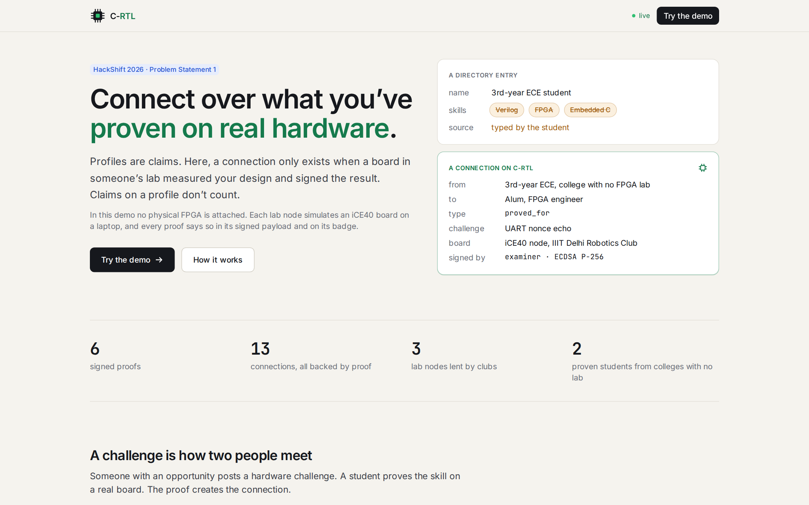

## The idea in plain words

You don't need to know anything about chips to follow this.

- **RTL** is what chip designers call the circuit descriptions they write, usually in a language called **Verilog**. It isn't a program that runs step by step. It describes wires and logic gates that all work at the same time.
- An **FPGA** is a chip that can rewire itself into whatever circuit you described. You load it with a file called a **bitstream**. Engineers use FPGAs to try a design before a factory makes it, and students use them to learn hardware.
- Circuit code that looks right often fails on a real chip, because real circuits have timing. So hiring managers ask one question: *did you get it working on a board?*
- Boards and lab time are concentrated in a few colleges. A student at a college with no lab can't answer that question, so "Verilog" on their résumé is just a word, and every profile looks the same.

**What C-RTL does:** clubs that own boards lend their idle ones as remote **lab nodes**. Next to each board sits a small, separate tester called the **examiner** (an ESP32 microcontroller). It talks to the student's circuit, measures what comes back, and signs the result with a key that never leaves it, like an invigilator signing an answer sheet. The platform only believes signed results, and only signed results create badges and connections.

```
 student's browser ──Verilog──▶ C-RTL platform ──job──▶ lab node (a club's laptop + board)
                                      ▲                    │ builds the circuit, loads it onto the board
                                      │                    ▼
               checks the signature ◀─┴── signed result ── examiner (tests the circuit, signs)
```

## One attempt, stage by stage

There are three people in the story. **Aarav** is a 3rd-year student at a college with no FPGA lab. **Meera** is an alum who now works at a chip company and is hiring. **Ishaan** runs the Robotics Club at IIIT Delhi and lends its board.

Every screenshot below comes from one real run on our deployed demo, taken by [a headless browser](tools/readme-shots.mjs).

### 1. Aarav sees his gap

Aarav wants Meera's *FPGA Design Intern* role. His profile says Verilog, FPGA and Embedded C, but those are struck through: nobody has tested them, so they count for nothing. He has 0 of the 6 skills the role needs. The page suggests challenges that close the gap, and the top one is Meera's, with her offer attached.

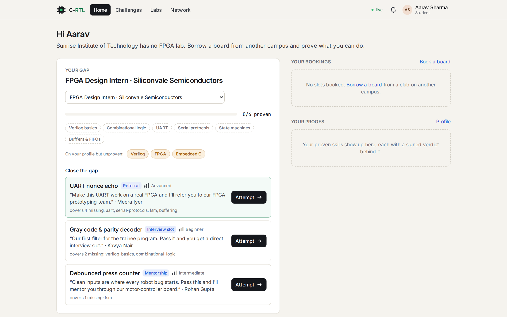

### 2. Meera's challenge comes with an offer

*"Make this UART work on a real FPGA and I'll refer you to our FPGA prototyping team."* A **UART** is the simplest way for two chips to talk: bits sent one after another down a wire at an agreed speed, here 115,200 bits a second. The test: the examiner sends a random code made up for this attempt only (a **nonce**), and the circuit has to echo it back at the right speed. A fresh code every time means nobody can replay someone else's answer.

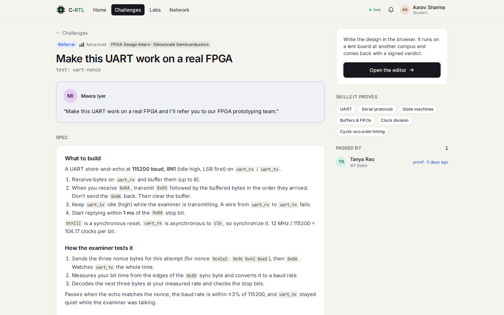

### 3. He borrows a board from another campus

Clubs list the boards they lend and when they're free. Aarav picks the Robotics Club bench at IIIT Delhi.

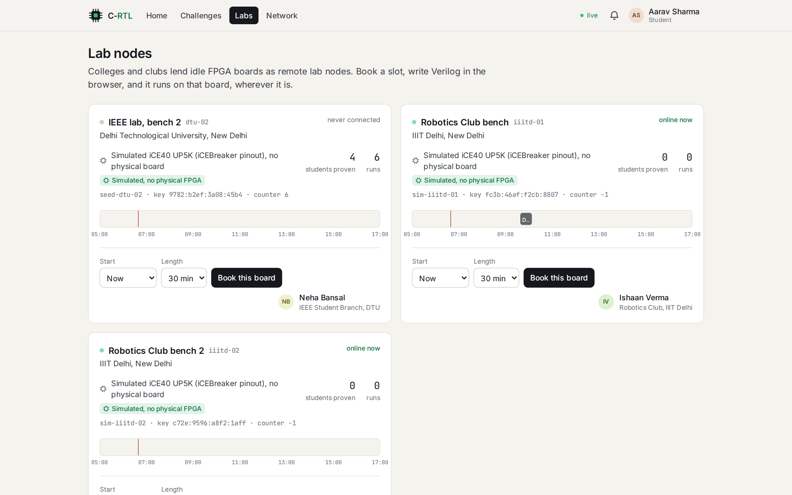

### 4. He books a slot and writes the circuit

He books 30 minutes on the board, writes his Verilog in the browser and presses **Build & simulate**. The bar on the right tracks the six steps an attempt goes through.

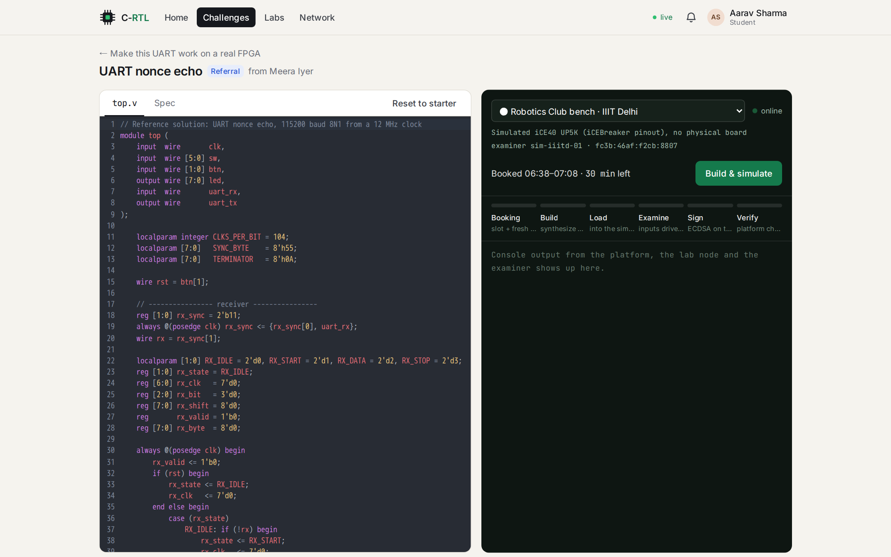

### 5. The lab node builds it and the examiner tests it

This is the lab node's own dashboard, on the club's machine. Each box is a step, in plain words:

1. Check the code for obvious mistakes.
2. Turn it into logic gates (**yosys**).
3. Place those gates on the chip and wire them up (**nextpnr**).
4. Pack the result into the bitstream a real board would be loaded with (**icepack**).
5. We have no physical board, so turn that same bitstream back into a circuit (**icebox_vlog**) and run it in a simulator (**iverilog**, **vvp**).
6. The examiner sends the nonce, measures the reply (115,385 bits a second; it has to be within 3% of 115,200) and signs **PASS**.

The whole attempt takes under half a minute.

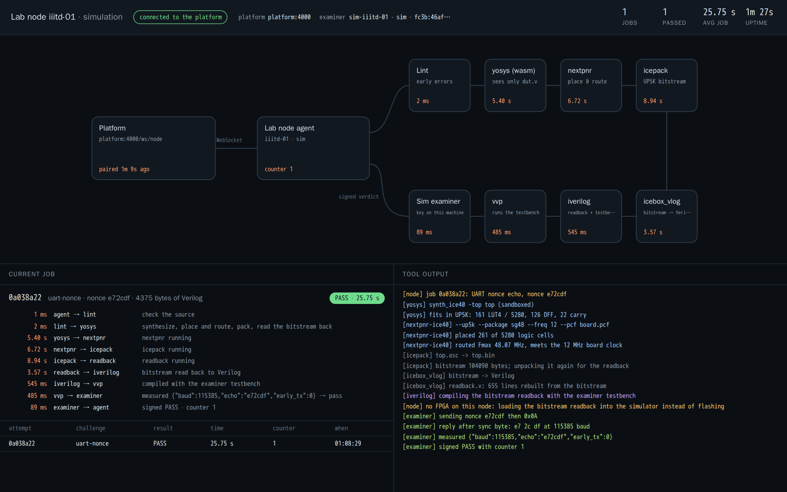

### 6. The platform checks the result before it believes it

The platform's live data-flow page shows every request, database write and message as it happens. The club's laptop only carries messages, and the platform runs six checks before writing anything:

- the signature is valid;
- the nonce is the one the platform issued;
- the node and challenge match the attempt;
- the result says what was tested;
- the examiner's counter has gone up, so an old result can't be replayed;
- Aarav really had that board booked.

Only then does it record the proof, the badge and two connections.

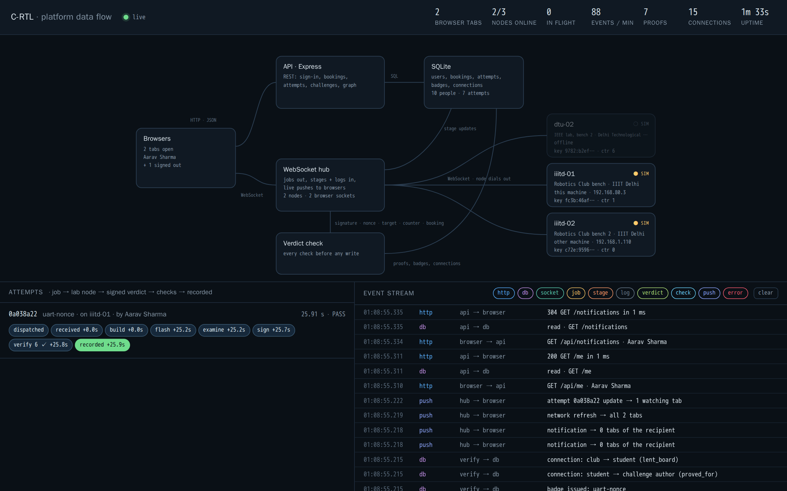

### 7. Pass: a badge and a connection

Aarav watches every check pass in his console. He now holds the badge and is connected to Meera, with the proof attached.

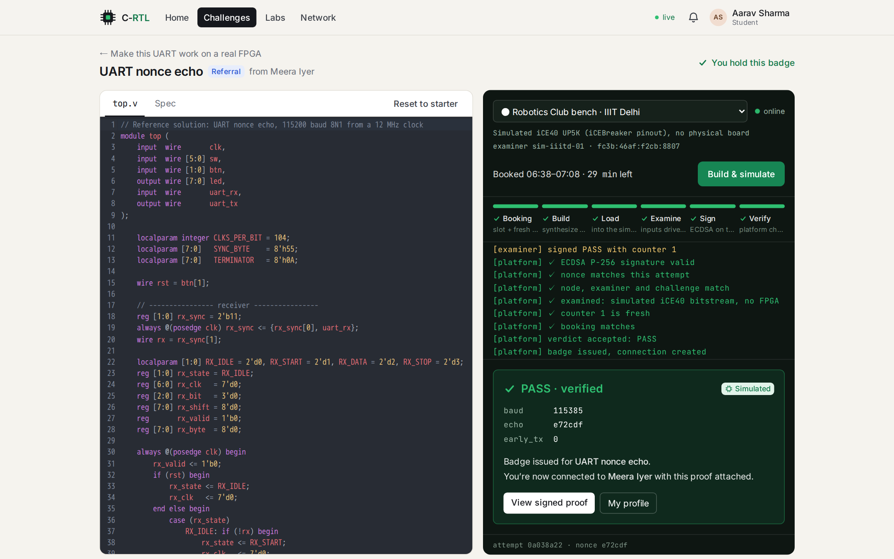

### 8. Meera gets a proof, not a résumé

The signed proof lands in Meera's inbox: who did it, on which board, signed by which examiner. She sends the referral she promised.

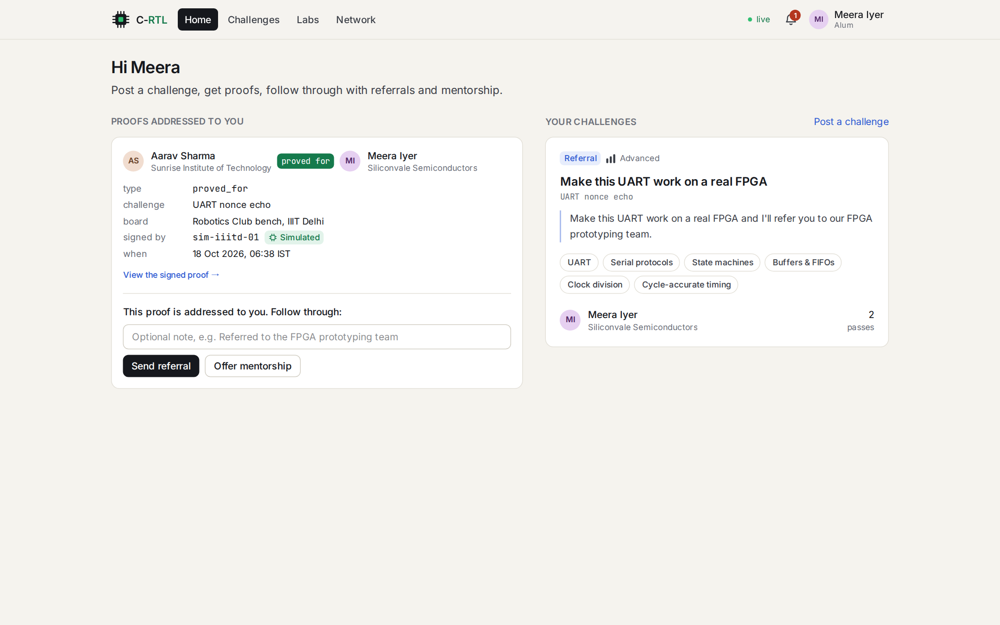

### 9. Aarav's profile now says something

His UART badge proves six skills, four of them ones the internship needed, and links to the signed proof. His typed claims are still struck through. He has three connections, and each one points at something that happened: Meera referred him, he proved a skill for Meera, and Ishaan's club lent him a board.

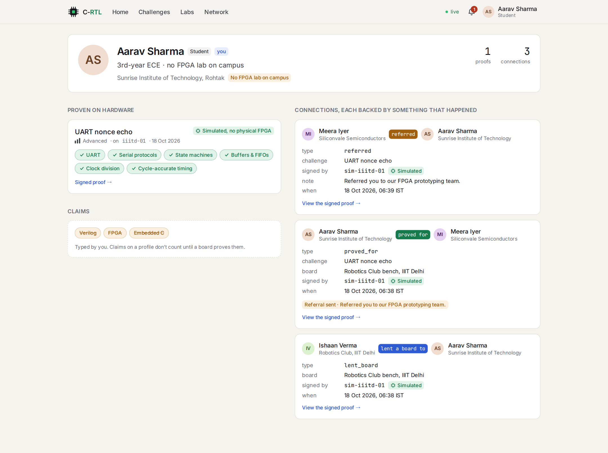

### 10. Anyone can check a proof without trusting us

Every proof has a public page that shows exactly what the examiner signed. **Verify signature** checks it in your own browser against the examiner's public key. Change one character, or press **Flip the result** to turn the pass into a fail, and the signature stops checking out.

<p align="center">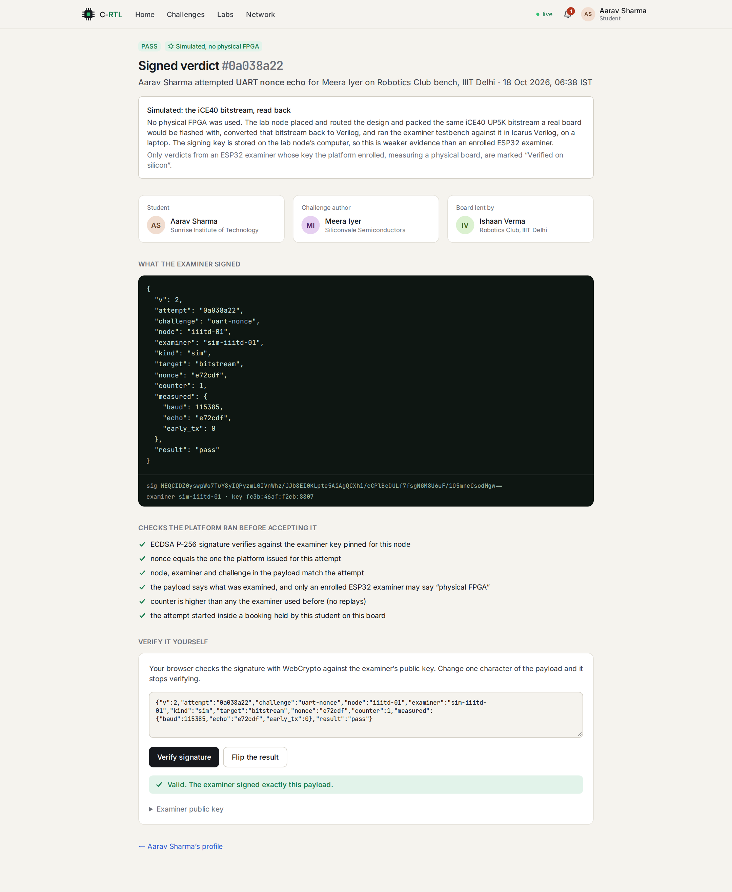</p>

### 11. The network is made of things that happened

There are no follow buttons. Every line in the graph is a challenge passed, a board lent, a referral sent or a mentorship started, and each one links to its proof.

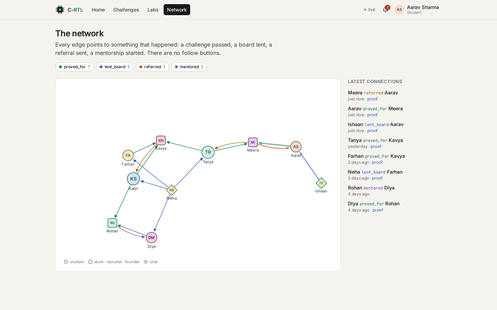

## What's real and what's simulated

**We don't have an FPGA board**, so every lab node in this build simulates one. It still builds the real iCE40 bitstream a board would be loaded with, then tests a circuit decoded from that bitstream rather than the student's source code. Every proof says so inside what was signed (`"target":"bitstream"`) and on its badge: **Simulated, no physical FPGA**.

In simulation the examiner is a program on the lab node's laptop and its key is stored there, so a simulated proof is weaker evidence than one from a real examiner chip, and the proof page says so. Nothing is labelled "Verified on silicon".

The examiner firmware runs on a real ESP32-S3 and signs verdicts that verify. It just has no FPGA to be wired to yet. With a board plugged in, the lab node loads the board instead of the simulator, and the same pipeline, checks and proof pages apply. Details are in [docs/SIMULATION.md](docs/SIMULATION.md).

## Try it

```bash
docker compose up -d --build
```

Open http://localhost:4000 and sign in as Aarav or Meera (demo sign-in, no password). The live data-flow dashboards are at http://localhost:4000/flow (platform) and http://localhost:4100 (lab node).

To run without Docker, plus tests and operator commands, see [docs/DEVELOPING.md](docs/DEVELOPING.md). To run a college's lab node on its own machine, see [docs/DEPLOY.md](docs/DEPLOY.md). The 4-minute stage demo is in [docs/DEMO.md](docs/DEMO.md).

## What's in the repo

| Folder | What lives there |
|---|---|
| [`rtl/`](rtl) | Four hardware challenges: spec, starter, reference solution, examiner testbench |
| [`server/`](server) | API, booking checks, verdict verification, WebSocket hub, SQLite, the `/flow` dashboard |
| [`web/`](web) | Verilog editor with live console, labs and booking, profiles, proof page, network graph |
| [`labnode/`](labnode) | Agent beside a lent board: builds the design, runs the examiner, has its own dashboard |
| [`examiner/`](examiner) | ESP32-S3 firmware that tests the FPGA's pins and signs verdicts |
| [`docs/`](docs) | [Architecture](docs/ARCHITECTURE.md) · [Verdict protocol](docs/PROTOCOL.md) · [Simulation](docs/SIMULATION.md) · [Hardware wiring](docs/HARDWARE.md) · [Deploy](docs/DEPLOY.md) · [Demo script](docs/DEMO.md) |

## Team

| GitHub | Built |
|---|---|
| [@sushant-mishra-dtu](https://github.com/sushant-mishra-dtu) | RTL challenges and testbenches, lab node agent, ESP32 examiner firmware, iCE40 flow |
| [@natyavidhan](https://github.com/natyavidhan) | Server: schema, API, booking and verdict verification, WebSocket hub |
| [@agrwljinal](https://github.com/agrwljinal) | Web: app shell and design system, challenges, Verilog editor and live console, home dashboard |
| [@jazzz7468-eng](https://github.com/jazzz7468-eng) | Web: labs and booking, profiles, proof page, network graph; docs and demo |
